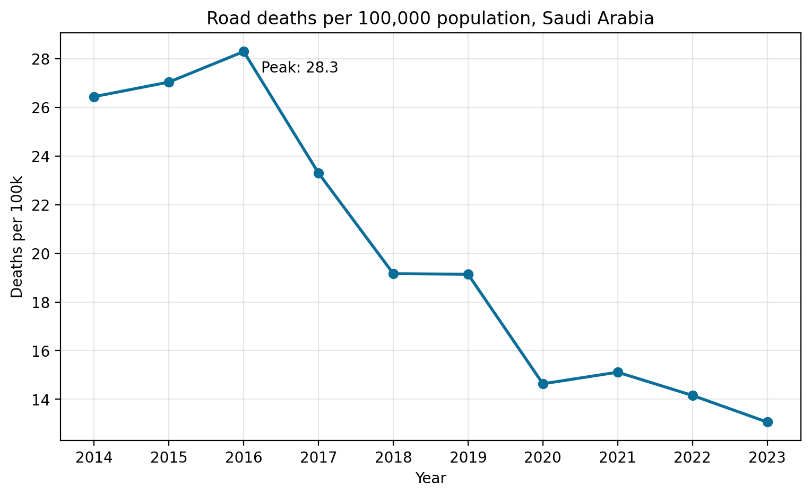
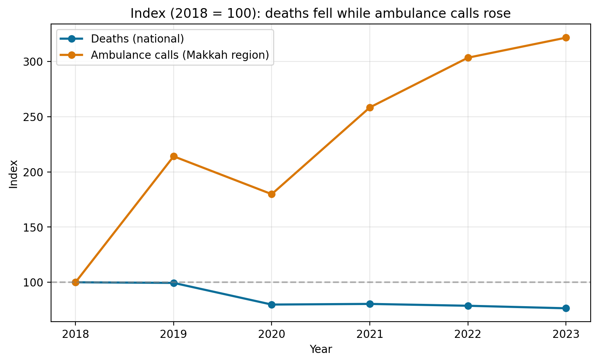
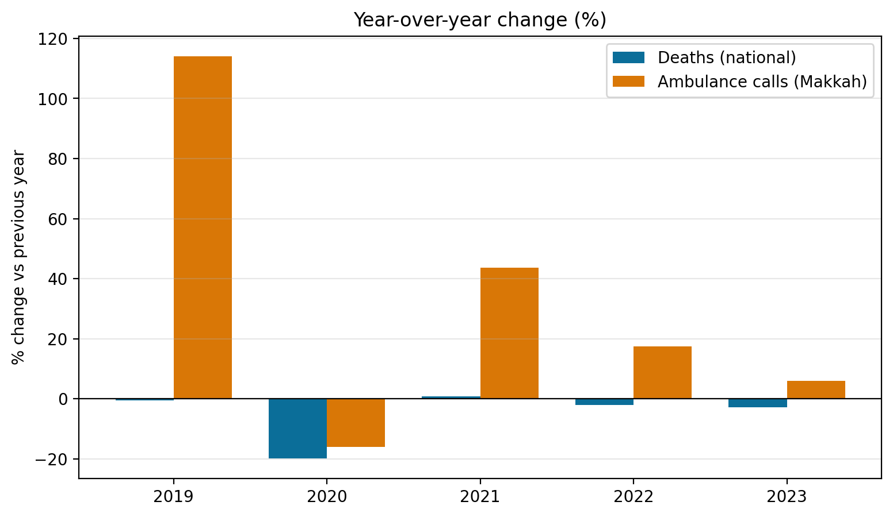

# Saudi Road Safety 2014–2023: Deaths Fell 41%, Yet Ambulance Calls Tripled. Why?

Road deaths in Saudi Arabia fell sharply over the last decade, yet ambulance calls for traffic accidents in the Makkah region kept rising. This project cleans two open datasets and compares their trends to understand the gap.

## Key findings
- National road deaths fell 40.9% (7,486 in 2014 to 4,423 in 2023); deaths per 100k fell 50.6%.
- Ambulance calls in the Makkah region rose about 3.45x (23,588 in 2018 to 81,480 in 2024).
- Calls jumped 114% between 2018 and 2019, which may reflect a change in coverage or reporting rather than a change on the roads.
- In 2020 both deaths and calls fell; after that they diverged.

## Charts

## Data
Saudi Open Data Platform (https://open.data.gov.sa), downloaded 14 October 2026:
- Injuries and Deaths from Road Traffic Accidents in the Last Ten Years (Ministry of Health)
- Total Ambulance Reports for Road Traffic Accidents in Makkah Region, 2018–2024 (Saudi Red Crescent Authority)

## Methods
- Cleaned and reshaped the data with pandas (Arabic-Indic digit conversion, wide-to-long reshape).
- Derived deaths per injury, year-over-year change, and implied population as a consistency check.
- Compared trends on a common index (2018 = 100).

## Limitations
- Calls cover the Makkah region only, while deaths are national, so trends are compared, not levels.
- Only 10 yearly points nationally and 7 regionally: no forecasting or causal claims.
- Explanations for the divergence are hypotheses and are not tested here.

## Run it
Open the notebook in Google Colab, upload `national.xlsx` and `makkah.xlsx`, then run all cells.

Tools: Python, pandas, matplotlib.
